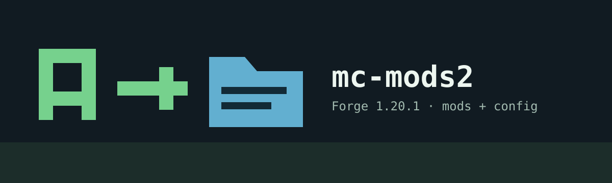

# mcmods2

**Owner: veyndor1 · Minecraft 1.20.1 · Forge 47.4.10 · Java 17**

## What Is This Project?

This is **veyndor1's mod and configuration feed for the owner's Minecraft pack**.
AutoModUpdater downloads the files selected here by the owner.

Only the owner manages this repository's publication. Public downloads let players
receive the owner's pack; they do not let other people publish their own packs or
administer this one. This is not a shared pack-hosting service.

## Why Use It?

Players in the owner's pack receive the same published mods and selected settings.
The owner updates one publication instead of sending every changed file by hand.
Players only need download access, not a GitHub account or publishing token.

## How Does It Work?

`mods-to-host/` and `config-to-host/` contain publishing inputs. `mods/` and
`configs/` contain immutable download artifacts. Older hashed artifacts remain
available so existing downloads can finish. `server-mods.json` selects the active
pack, with identity `mc-mods2-1.20.1`.

The build's default feed is
`https://raw.githubusercontent.com/veyndor1/mcmods2/main/server-mods.json`.
Publishing rights come from repository permissions, not from knowing this URL.

## How Do I Use It?

Use this build when joining **the owner's `mcmods2` pack**, following the owner's
instructions. Download `AutoModUpdater-1.jar` from the
[latest pack updater release](https://github.com/veyndor1/mcmods2/releases/latest)
and put one copy in that Forge profile's `mods` directory. Do not install it in
an unrelated pack: it downloads this pack's mods and applies its published settings.

[AutoModUpdater](https://github.com/veyndor1/AutoModUpdater) contains the updater
source and build tools on branch `1.20.1`, plus releases of the same pack-player
build. The owner has chosen to keep that repository public; its proprietary license
still applies. Public source or binary access does not grant `mcmods2` write access.

The separate `mc-mods` repository targets **Minecraft 1.12.2**. It is outside this
1.20.1 distribution and is not an updater integration or fallback source.

## Detailed Step-by-Step Installation

### For the owner's pack players

1. Confirm that the owner directed you to this pack and install Minecraft 1.20.1,
   Forge 47.4.10 and Java 17 as instructed.
2. Close Minecraft and wait for any previous installer helper to finish.
3. Download the complete updater JAR, or extract it from the license-inclusive ZIP.
4. Keep one updater JAR in this pack profile's `mods` folder. Keep the license
   notices with your downloaded package and check the supplied SHA-256 values.
5. Start the pack and follow the update window. Mod/updater replacements are
   installed after exit; config-only changes can continue in the current process.

### For the owner publishing this pack

1. In the updater source project, put compatible mod JARs directly in `mods-to-host`.
2. Put the **contents** of the selected config directory in `config-to-host`;
   do not wrap them in another `config` directory.
3. Build the complete updater when its software version changes, then run
   `make-manifest.bat`. This prepares a local publication and does not upload it.
4. Using the owner's authorized access, upload immutable artifacts to `mcmods2/main`
   first and `server-mods.json` last. Keep old artifact URLs available for in-flight
   downloads. Publish the complete updater through Releases when distributing it.

Each published config root is authoritative. Changed roots are backed up under
`.automodupdater/packs/mc-mods2-1.20.1/config-backups` and replaced completely;
extra files inside a published root are removed. Unpublished roots and the updater's
own `config/automodupdater.json` are preserved. Missing unpublished config directories
are left for their mods to create. Configs accompanying changed mods activate with
those mods after the game exits.

### Current pack: Mirza gaga denemesi

The 2026-10-15 publication contains **142 mod JARs** and **9 changed optimization
config files**, grouped into 8 manifest entries. Mod binaries and selected config
files are copied without editing their contents. Other mod settings are generated
by the mods or kept by the player.

Published config files:

- `asyncparticles/asyncparticles.json`
- `asyncparticles/asyncparticles-mixin.properties`
- `bons_and_furious.properties`
- `c2me.toml`
- `embeddium-options.json`
- `flerovium.json`
- `flywheel-client.toml`
- `modernfix-mixins.properties`
- `saturn-optimizations.toml`

The selection includes the final seven engine/optimization config files and the
retained Embeddium/Flywheel worker settings. Restored graphics configs, vanilla
`options.txt`, worlds, launcher settings, account data and test tools are excluded.
Selected files are complete files, including any existing graphics fields in
`embeddium-options.json`. This publication does not promise a particular FPS or
reproduce machine-specific GPU, memory or launcher settings.

The updater has a proprietary binary-use license. The repository metadata license
does not relicense the updater or third-party mod binaries/configuration content.
